\---  
title: JOIN 字段覆盖加伪造 MIME：Photographer 拿 FLAG  
published: 2026-10-13  
description: User::findById 用 JOIN 拉背景图，photo.type 会盖掉 user.type；上传时 MIME 信任客户端。把 type=-1 的图设成背景后，Auth::type() 变成 -1，即可读 /superadmin.php 的 FLAG。  
tags:  
\- 代码审计  
\- PHP  
category: CTF  
draft: false  
\---

:::warning[题目性质]  
本文是 CTF 题目 **Photographer** 的解题记录，环境为本地靶机，仅用于学习代码审计与权限校验问题。  
:::

`User::findById` 用 JOIN 拉取背景图，`photo.type` 会覆盖 `user.type`；上传时 MIME type 直接信任客户端。上传一张 `type=-1` 的图片并设为背景后，`Auth::type()` 变为 `-1`，满足 `/superadmin.php` 的低权限校验，从而读取 FLAG。

## 一、先看站点

注册后访问，是一个 blog 系统。

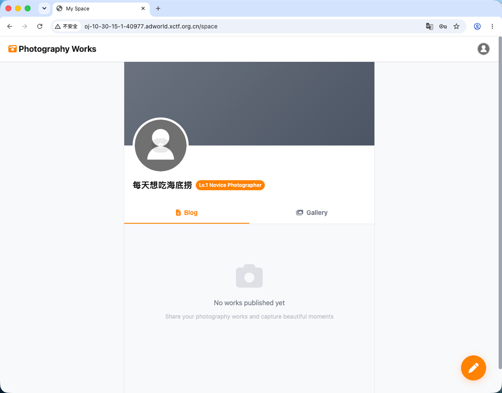

背景图是在发布 blog 后引用 blog 资源。

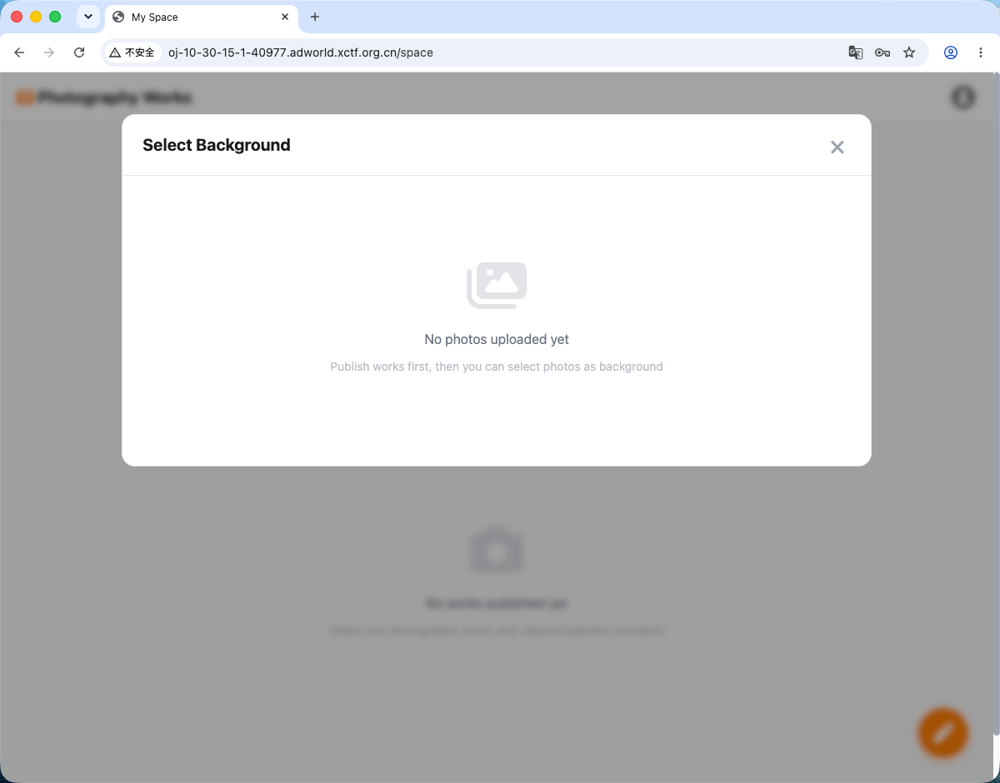

发布后可以在背景图中选择 blog 图片作为背景图。

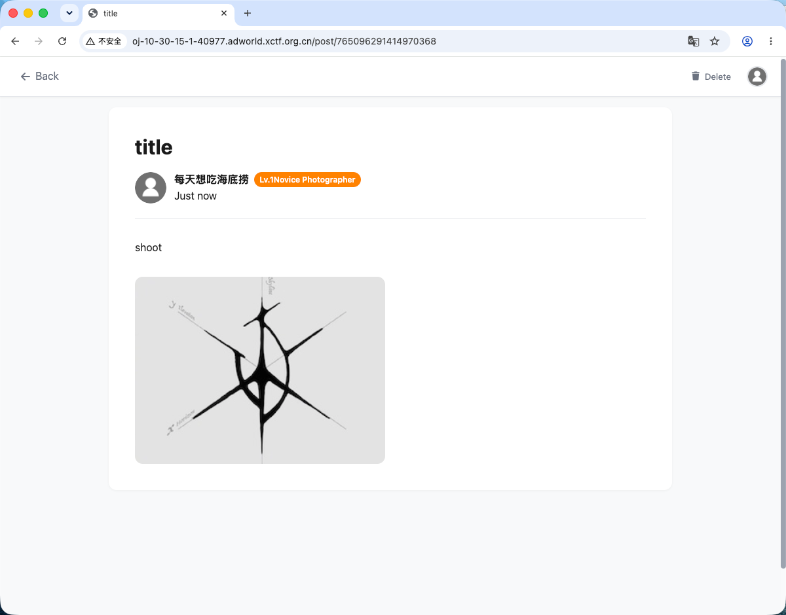

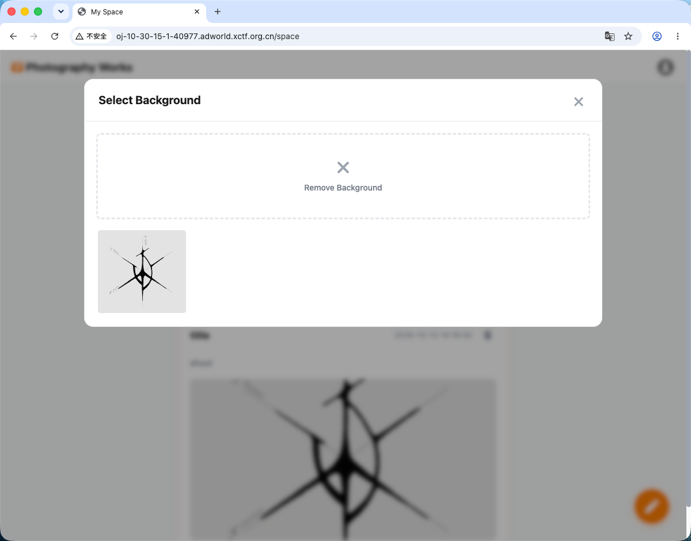

## 二、/superadmin.php 的校验

依旧去看源码，先看题目里面提到的 `/superadmin.php`。

代码逻辑是先检查登录状态，再看 `Auth::type()`，如果小于 admin 用户的值，则返回 FLAG。

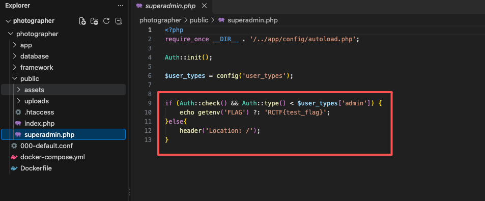

搜一下 `'admin'`，可以得到：

```php
'admin' => 0,
'auditor' => 1,
'user' => 2
```

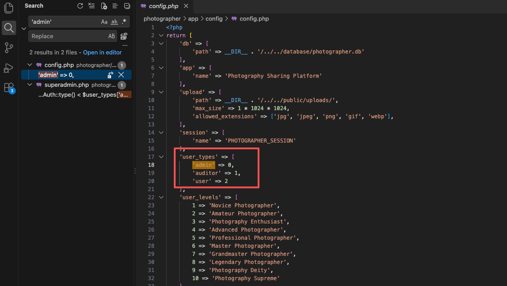

注册的普通用户 `type=2`，需要让 `Auth::type()` 返回小于 0 的值。

## 三、认证机制

再去看认证机制：

```php
if (isset($_SESSION['user_id'])) { // 判断当前会话 $_SESSION 中是否存在 user_id。如果用户登录成功，会把用户 ID 存进去。
            self::$user = User::findById($_SESSION['user_id']); // 调用 User 类的静态方法 findById()，根据会话里的 user_id 去数据库或其它存储中查找对应的用户记录，并把查到的用户对象赋值给当前类的静态属性 $user。
        }
```

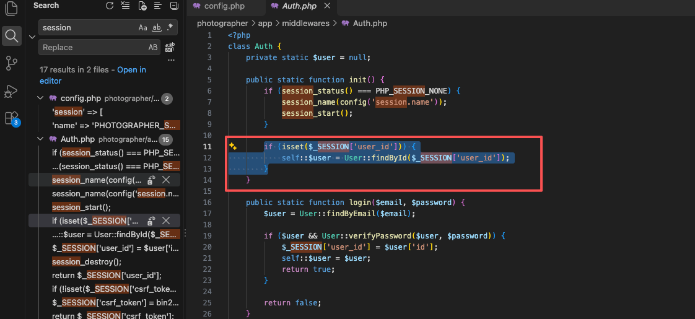

这里有两个注意点：

- `$_SESSION` 存在服务端，一般不能直接被客户端篡改。
- `findById()` 内部应该使用参数化查询，防止 SQL 注入。

## 四、findById 的 JOIN 覆盖

再看 `findById` 方法：这里根据给定的用户 ID，从 `user` 表中找到该用户，并同时获取其关联的 `photo` 表信息（通过 `background_photo_id` 关联）。最终返回一个包含用户字段和照片字段的对象（如果照片不存在，照片字段为 `null`）。

```php
public static function findById($userId) {
        return DB::table('user')
            ->leftJoin('photo', 'user.background_photo_id', '=', 'photo.id')
            ->where('user.id', '=', $userId)
            ->first();
    }
```

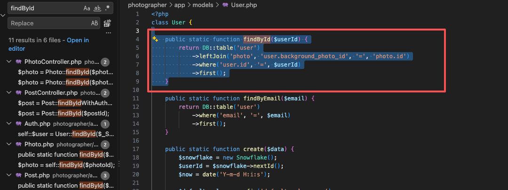

**关键问题：** [SQLite3Result::fetchArray Doesn't Handle Join Statement Properly · Issue #20300 · php/php-src](https://github.com/php/php-src/issues/20300)

该方法使用了 LEFT JOIN 将 `user` 表和 `photo` 表连接起来（通过用户的背景图片 ID）查询所有字段，**当 JOIN 查询存在同名字段时，后面 JOIN 的表的字段会覆盖前面表的字段**。

- `user` 表有 `type` 字段（存储用户类型：0=admin, 1=auditor, 2=user）
- `photo` 表也有 `type` 字段（存储图片的 MIME 类型，如 `image/jpeg`）

当用户设置了背景图片后，`findById` 方法返回的结果中，`type` 字段会被 `photo.type` 覆盖。

## 五、上传逻辑信任客户端 MIME

再看图片的上传逻辑。`$file['type']` 来自客户端，直接使用客户端提供的 MIME 类型，这里可以被伪造。上传一个恶意脚本，将 type 设置为 `image/jpeg`，如果服务器端仅依赖这个 type 进行验证，就会导致安全漏洞。

```php
$file = [
  'name' => $files['name'][$i],
  'type' => $files['type'][$i],
  'tmp_name' => $files['tmp_name'][$i],
  'error' => $files['error'][$i],
  'size' => $files['size'][$i]
];
.....
$result = Photo::create([
  'user_id' => Auth::id(),
  'original_filename' => $file['name'],
  'saved_filename' => $savedFilename,
  'type' => $file['type'],
  'size' => $file['size'],
  'width' => $exifData['width'],
  'height' => $exifData['height'],
  'exif_make' => $exifData['make'],
  'exif_model' => $exifData['model'],
  'exif_exposure_time' => $exifData['exposure_time'],
  'exif_f_number' => $exifData['f_number'],
  'exif_iso' => $exifData['iso'],
  'exif_focal_length' => $exifData['focal_length'],
  'exif_date_taken' => $exifData['date_taken'],
  'exif_artist' => $exifData['artist'],
  'exif_copyright' => $exifData['copyright'],
  'exif_software' => $exifData['software'],
  'exif_orientation' => $exifData['orientation']
]);
```

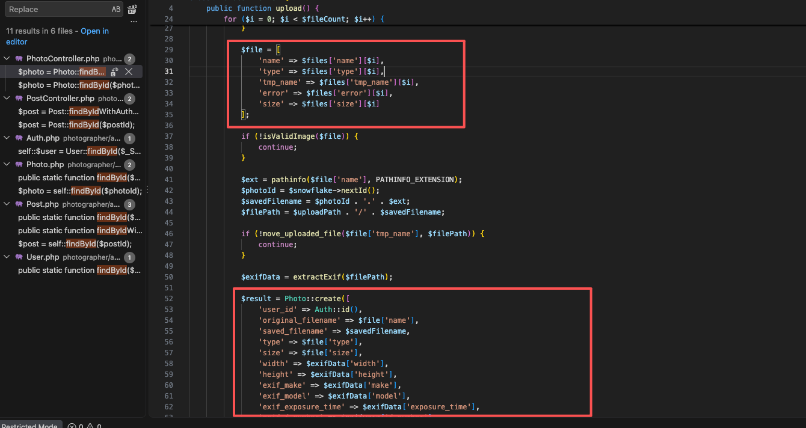

`framework/helpers.php` 只校验了扩展名、大小、是否为真图片，完全没校验 MIME 值。因此只要**文件本体是一张合法图片**，就能把 `type` 伪造成任意值，包括 `-1`。

```php
function isValidImage($file) {
    $allowedExtensions = config('upload.allowed_extensions');
    
    $ext = strtolower(pathinfo($file['name'], PATHINFO_EXTENSION));
    if (!in_array($ext, $allowedExtensions)) {
        return false;
    }
    
    if ($file['size'] > config('upload.max_size')) {
        return false;
    }
    
    $imageInfo = @getimagesize($file['tmp_name']);
    if ($imageInfo === false) {
        return false;
    }
    
    return true;
}
```

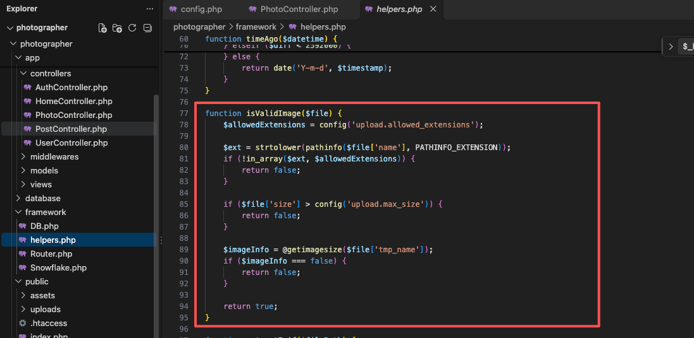

所以上传一张照片，将照片的 MIME type 设置为负数。

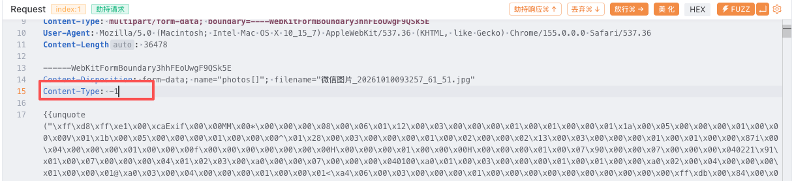

将背景图设置为上传的图片，此时 `type` 已被替换为 `-1`。

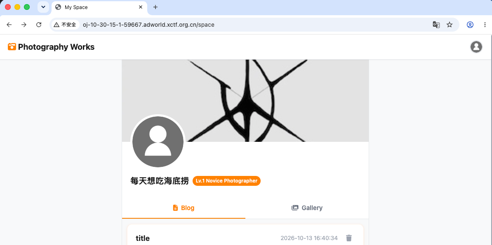

访问 `/superadmin.php`，此时 `Auth::type()` 满足小于 0 的条件，成功获取 FLAG。

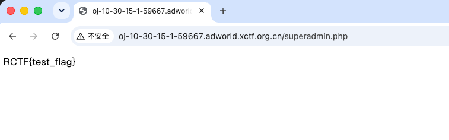

## 写在最后

这道题的得分点不在上传绕过本身，而在 **两个本不该相遇的字段，在一次 JOIN 里撞了名**。权限用的是 `user.type`（整数角色），图片用的是 `photo.type`（MIME 字符串）。PHP 的 SQLite 驱动在 `fetchArray()` 遇到同名列时，后表会盖掉前表，于是登录后每次取当前用户，角色就变成了背景图的 MIME。客户端再把 MIME 改成 `-1`，`Auth::type() < 0` 就成立了。

补几条审计时值得记住的点：

- **JOIN 不要 `SELECT *`。** 两表都有 `id`、`type`、`user_id` 这类名字时，关联查询必须写清 `user.type AS user_type`、`photo.type AS mime_type`。PHP 这边对应的就是 [php-src#20300](https://github.com/php/php-src/issues/20300)：同名列在结果集里只留一个，而且是后面的那个。
- **权限字段和业务字段不要同名。** 角色、状态、MIME、文件类型各用各的列名，就算 ORM 偷懒全量取出，也不会把「我是谁」覆盖成「这张图是什么」。
- **`$_FILES['type']` 是浏览器填的，不是事实。** 真实类型看 `finfo_file` / `getimagesize` 的返回值，MIME 只当展示，不能写进权限判断，更不能当成整数去比较。
- **比较角色时先定类型。** `Auth::type()` 若可能拿到字符串 `image/jpeg` 或 `"-1"`，用松散比较 `< 0` 会走出意料之外的分支。角色校验应只接受白名单里的整数，其它值一律当未授权。

一句话：信任边界在服务端自己算出来的列，不在客户端声明的 MIME，也不在一次没起别名的 JOIN 结果上。
